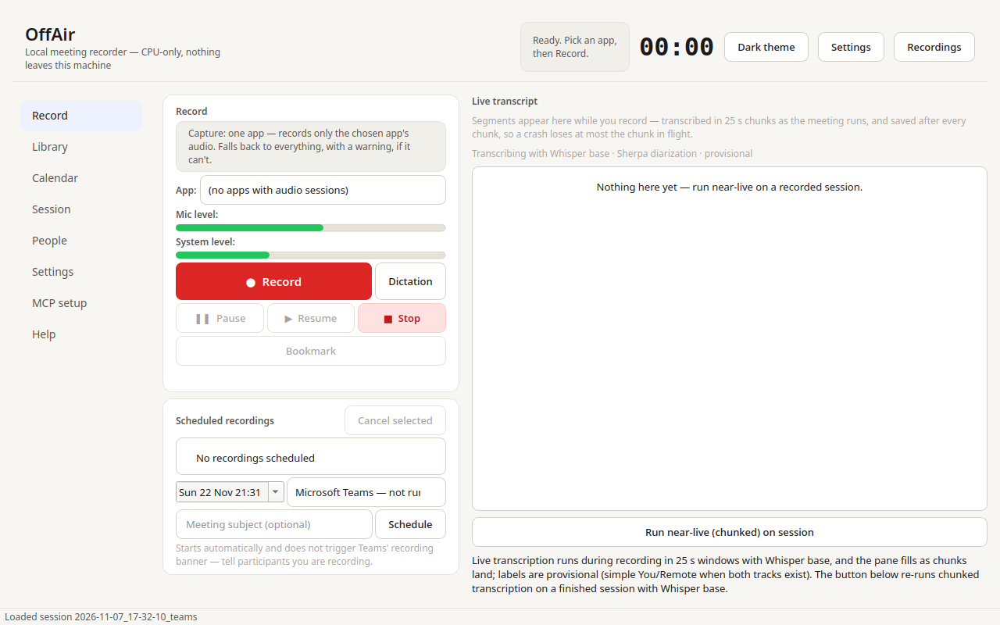
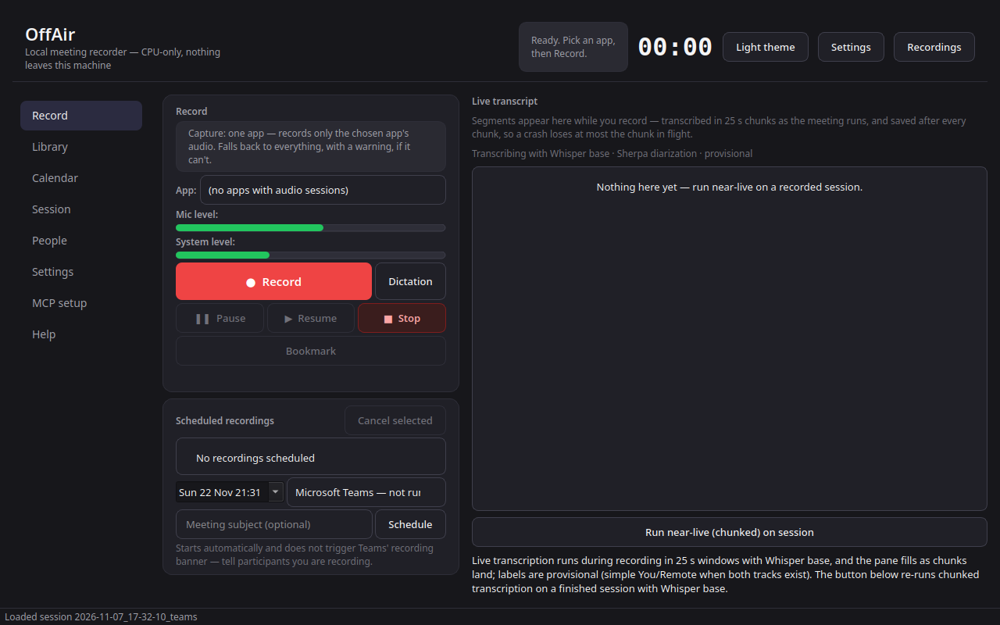
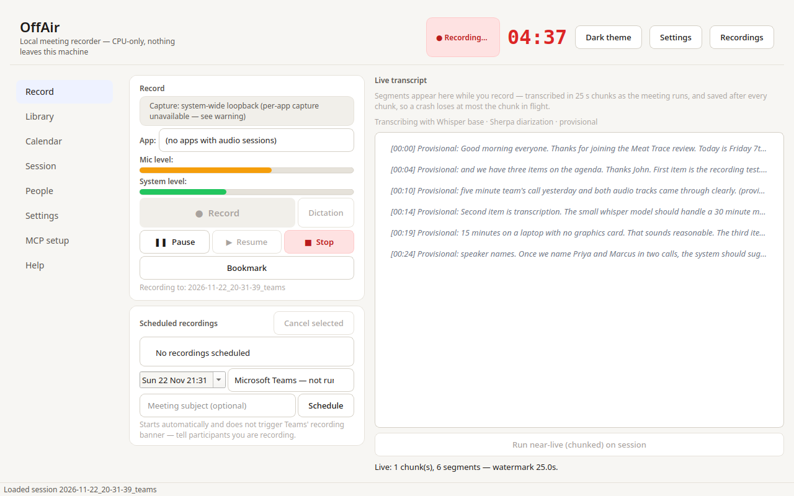

# OffAir — Local Meeting Recorder, Transcriber & Speaker Learning

OffAir records Microsoft Teams (and other) calls on your own machine,
transcribes them, tells speakers apart, and learns to recognise the
people you meet with — all locally. No cloud, no GPU, no CUDA, no
account. Audio, transcripts and voice profiles never leave the machine.

## What it does

- **Records** a call to separate microphone and system-audio tracks
  (48 kHz mono), plus a mixed track and a `metadata.json` per session.
- **Transcribes** with faster-whisper on CPU (int8), to timestamped
  `transcript.json` / `.txt` / `.srt`.
- **Diarizes** — labels each transcript segment with a speaker — in
  three modes: instant You/Remote, full multi-speaker, or sherpa
  (multi-speaker, no account or token needed).
- **Learns speakers across calls.** Voices are recognised
  automatically and keep the same label from call to call —
  unnamed ones become "Speaker A", "Speaker B", … until you
  name them, and a name then applies to every past session.
  Confirm/Correct still works for anything the app got wrong,
  with confidence and margin shown for every suggestion.
- **Searches recordings** by exact text, by meaning, or both.
- **Cleans transcripts** automatically — fillers removed into a
  derived `transcript-clean.*` (the verbatim transcript is never
  edited; repeats are kept verbatim) — and can AI-polish
  with the local LLM into a clearly marked rewrite. A names
  dictionary keeps product names and jargon spelled right.
- **Exports** a clean Markdown transcript for an LLM, or summarises
  on-device with a local LLM (Ollama on localhost, off by default).
- **Shows a calendar of recordings.** The Calendar view shows a month
  grid — one badge per recording (time, app, recording source, and
  the linked Outlook event subject when there is one) — with Work
  week (Mon–Fri) and Day views alongside it. Click a
  badge to load that session. A speaker filter above the grid dims
  days with no matching session instead of hiding them.
- **People pages.** From the People view, open a speaker's page:
  every meeting they took part in (with utterance counts),
  everything they said (click to hear it), and their voice sample.
- **Bookmarks.** Mark a moment while recording (Bookmark button or
  Ctrl+B); the Session view lists them under the waveform —
  click one to hear that moment. Bookmarks whose audio was deleted
  by retention render disabled, with the reason.
- **Dictation.** The Dictation toggle beside Record records mic-only
  notes — the spoken side only, never the other side of a
  conversation — cleaned into a readable note.
- **Enterprise cleanup (opt-in).** Sends transcript text only to the
  Claude Code CLI on this machine and writes a third, explicitly
  labelled "Enterprise-cleaned" variant. Audio never leaves the
  machine; the verbatim transcript is never changed.
- **Waveform.** The Session view shows the session's loudness,
  coloured by speaker, with bookmark markers; click it to hear
  that moment.
- **Library pins, names and week groups.** Star a session to pin it first;
  the unfiltered list groups under "This week" / "Week of …"
  headers. Each row shows the session's name and date, then its
  duration, speakers and source. Rename a session that is not tied
  to an Outlook calendar event; Delete removes a session permanently,
  after a confirmation. A speaker filter narrows the Library by who spoke, and
  the footer shows free disk space and what retention would delete.
- **Keyboard shortcuts, theme toggle, tray.** Ctrl+B bookmark,
  Ctrl+P pause/resume, Ctrl+K jump to search (in-app only); one
  header button switches light ↔ dark and remembers it; the tray
  icon (where a tray exists) shows recording time and offers
  Show / Stop / Quit.
- **Pre-roll (opt-in, off by default).** A short memory-only buffer
  of audio from before you press Record, added to the start of the
  recording when one starts — nothing is written to disk unless a
  recording starts. The consent note in Settings says exactly
  what is kept.
- **First launch + low-disk warning.** The first launch shows a
  short onboarding pass — what happens, what stays on the machine,
  and the one-time model downloads; it never nags again (the same
  text lives in Help). While recording, a warning fires if free
  disk on the recordings volume drops below 1 GiB; a recording is
  never stopped for disk reasons.
- **Documents itself in-app.** The Help view renders the `docs/`
  Markdown files — recording, transcription, diarization, speakers,
  search, calendar, Outlook linking, retention, cleanup, scheduled
  recordings, keyboard shortcuts, MCP, and the privacy story — so
  the help in the app is the repo docs, not a copy of them.

## Screenshots


*Main window, light theme (default) — Record view: app picker, live level meters, Record/Pause/Stop, the Bookmark button on its own row below the transport buttons, the Dictation toggle beside Record, the "Scheduled recordings" card below, and the live transcript beside it.*


*Same window, dark theme.*


*Mid-recording — red status pill, running timer, live meters, Pause/Stop enabled, the Bookmark button on its own row below the transport buttons, and live chunks marked "provisional".*

More screenshots — every view, the Recording Browser, search, and
Settings — live in [docs/SCREENSHOTS.md](docs/SCREENSHOTS.md).

Rendered offscreen on Linux from the demo sessions, so the device
dropdowns show "(no microphone found)" — the render machine has no
audio hardware. On a real machine they list your mic and loopback
devices.

## How it works

The workflow is: record → transcribe → diarize → name/learn speakers
→ export or search. Every step runs on-device, in a background thread,
so the UI stays responsive. By default the whole pipeline runs
**automatically when a recording stops** — transcribe (base) →
diarize (sherpa) → identify speakers — with progress in the status
bar; turn it off in Settings ("Automatically process recordings")
and the manual buttons do the same steps on demand. The first run
downloads the Whisper base model (~142 MB) and the sherpa models
(~33 MB); a 30-minute meeting takes roughly 4 minutes to
transcribe on a 4-core machine, plus ~1–2 minutes to diarize.

### 1. Record

The Record view keeps only what recording needs: the **App** picker, the capture-mode callout, live level meters, Record/Pause/Resume/Stop, and the live transcript beside it. The microphone and system-audio (loopback) devices are picked in Settings ("Recording devices"). The **App** picker lists the apps that currently have audio sessions — friendly name plus whether it is playing sound right now (e.g. "Google Chrome — playing sound" / "Microsoft Teams — idle"); the list refreshes when you open it, so pick the app to record, or "Other app…" to type an exe name by hand. Teams is the default pick when it has a session. **Record:** picks what is captured — "Record one app" (only the picked app's audio; falls back to everything you hear, with a loud warning, if that app can't be captured) or "Record everything you hear" (all sound from your speakers). The choice lives in Settings ("System audio capture") and the Record view shows it as a callout. Click **Record**, join your call, then **Stop**.

- Each session is a folder under `~/OffAir/recordings/` (on Windows
  `C:\Users\<you>\OffAir\recordings`) containing:
  - `mic.wav` — your microphone only
  - `system.wav` — system audio (everyone else)
  - `combined.wav` — mic + system mixed, 48 kHz mono int16
  - `metadata.json` — start/end time, duration, devices, mode, warnings
- **Recording source.** Every session records what it is a recording
  of: `source` + `source_detail` in `metadata.json`. The source is
  auto-detected from the app picked above — Teams, Zoom, Webex, a
  browser (Chrome / Edge / Firefox / Brave / Opera), or `solo` when
  no app is picked — and an unknown app is `other`, never a guess.
  Google Meet runs inside a browser, so it is `browser` by
  detection; the **Default recording source** in Settings overrides
  detection — pick `Google Meet` for a Meet call,
  or `Claude Code` for a working session with the agent (mic +
  system audio, nothing running identifies it). The override always
  wins, and the chosen value is what the session stores. A wrong
  source can be corrected later from the Session view (see §6), and
  sessions recorded before this field existed are backfilled from
  their stored app name where that maps cleanly, else `other`.
  The full mapping, enum, and MCP contract are in
  [docs/RECORDING_SOURCE.md](docs/RECORDING_SOURCE.md).
- **Pause** discards audio received while paused, so the tracks stay
  in sync. **Resume** continues the same session.
- Live level meters show mic and system levels while recording.
- **Devices run at their native sample rate.** If your microphone or
  loopback device only supports 44.1 kHz (e.g. Remote Audio over an
  RDP session), OffAir opens it at 44.1 kHz and resamples to 48 kHz —
  the WAVs are still 48 kHz mono int16, and `metadata.json` records
  the device's native rate (`mic_stream_sample_rate` /
  `system_stream_sample_rate`). Before this fix (Nov 10 2026) a
  44.1 kHz-only loopback device crashed the app on Record, because
  the stream was opened at a fixed 48 kHz the device refused.
- The system track captures **only the target app's audio** (Teams
  by default) through Windows' Application Loopback API. If per-app
  capture is unavailable — older Windows build, app not running,
  activation failure — it falls back to system-wide loopback, which
  carries everything playing on the machine; the mode that actually
  ran is recorded in `metadata.json`, and the Settings picker lets
  you force "Teams only" (fail loudly instead of falling back) or
  "System-wide loopback". Known exception: the Teams desktop app
  itself — process loopback returns silence for it even mid-call,
  so Auto records Teams meetings system-wide, with a warning.
  Per-app capture is verified on real Windows
  (Nov 8 2026, Windows 11 VM): a 440 Hz tone player as the target
  came back a clean 440.0 Hz on the per-app track and on the fallback
  track. A real Teams meeting is still the open gate for the whole
  pipeline (see
  [docs/PER_APP_CAPTURE.md](docs/PER_APP_CAPTURE.md)).
- **Two loud warnings instead of a silent recording.** If the picked
  app has no audio session when you press Record, OffAir waits a
  few seconds for one to appear (a call connecting creates it),
  then asks — naming the cause ("isn't running" vs "running but
  not playing sound") — "Record anyway (system-wide)" or Cancel,
  instead of recording silence.
  And while recording, if the system track stays silent for ~10 s
  while the mic is live, the status line says so ("No system audio
  detected — check the target app is playing sound and the right
  output device is selected") and clears itself when system audio
  comes back.
- **Auto-detect (opt-in, Windows only).** Tick "Start recording
  automatically when a Teams meeting starts" in Settings and OffAir
  watches Teams' audio activity: recording starts when a meeting
  starts (Teams session active with sustained audio, ~2–3 s
  debounce, so a notification blip never starts one) and stops when
  it ends (the Teams session going inactive, or Teams exiting —
  silence during a meeting never stops it). An auto-started recording
  shows an **AUTO** badge on the Record card and runs through the
  same auto-processing as a manual one. Stopping one by hand does
  not restart it until the meeting ends. **OffAir does NOT trigger
  Teams' own recording banner — tell everyone in the meeting that
  you are recording.** The auto-detect probe now runs on real Windows
  (Nov 8 2026, Windows 11 VM — session found, live peak reading, no
  probe error); a real Teams meeting start/stop is still the open
  gate (see [docs/PER_APP_CAPTURE.md](docs/PER_APP_CAPTURE.md)).
- **Scheduled recordings (Nov 22 2026).** One-off timers on the
  Record view: pick a time, an app, and an optional meeting subject
  and OffAir starts recording automatically at that time — only
  while the app is running (no background service in v1), stopping
  only when you press Stop. An agent can set them too, through the
  MCP scheduling tools, from your Outlook calendar for the day.
  **Scheduled auto-start does NOT trigger Teams' recording banner —
  tell participants you are recording.** Full detail, including the
  v1 limits: [docs/SCHEDULED_RECORDING.md](docs/SCHEDULED_RECORDING.md).

### 2. Transcribe

By default transcription starts automatically when a recording
stops (Whisper `base`), with progress in the status bar — the
transcript is finalized on every Stop (live chunks + tail, or the
whole file when there is no live state) whether or not
auto-processing is on; the setting gates only the diarization →
speaker-identification chain that follows it. Or pick
a model in the "Transcription model" dropdown and click
**Transcribe session** to run it manually. A transcription
can be stopped with the **Cancel** button next to it: it stops
after the current segment, discards the partial segments, and
writes no `transcript.json` — and a cancel requested while the
model is still downloading (first run) takes effect once the
model has loaded, since the download cannot be interrupted
mid-download. Cancelling the Stop finalize leaves the saved live
transcript (`transcript-live.json`) on disk, so the session stays
transcribable by hand. Every Session-view
action works on the session shown in the "Loaded session" line
at the top of the view — pick another session in the Session
chooser there, or open one from Recordings (see §6). It writes `transcript.json`,
`transcript.txt` and `transcript.srt` into the session folder. The
first run downloads the selected model (base, ~142 MB, by default) — after that, transcription
is fully offline.

Live transcription (Nov 19 2026): while a recording runs, the
transcript already grows in the Live transcript pane on the Record view in 25-second
windows using the configured model (`base` by default — a 25 s
chunk takes ~3.4 s, comfortably real-time), with provisional
You/Remote labels. After every chunk the progress is saved to
`transcript-live.json` in the session folder, so a crash loses at
most the chunk in flight. When you stop, only the tail — the audio
after the last completed window — is transcribed, then merged
with the live chunks (duplicates at the 0.5 s overlaps are
dropped) into the canonical `transcript.json` / `.txt` / `.srt`
and `transcript-live.json` is deleted. If there is no live state
(a crash before the first chunk, or an interrupted recording),
Stop falls back to transcribing the whole file. Pausing the
recording pauses live transcription too; it resumes with the
recording. On a first run the model download is shown as
"Downloading Whisper base (~142 MB) — first run only" with
elapsed time — faster-whisper gives no byte-level download
progress, so there is no progress bar for it.

| Model | Size | Speed on CPU | Accuracy |
|-------|------|--------------|----------|
| tiny  | 75 MB  | fastest | lowest — drafts and search |
| base  | 142 MB | ~2× faster than small | good for clear speech — the default |
| small | 466 MB | ~2.5× slower than base | same accuracy as base on clean audio — opt-in |
| medium| 1.5 GB | ~3–4× slower than small | better, rarely worth the wait on CPU |

Measured on a 61-second test recording (4 vCPU Linux VM, much weaker
than the target laptop): tiny 4.3 s (RTF 0.070), base 8.3 s (0.135),
small 20.4 s (0.333), all at 7.5–8.0% word error rate. Extrapolated,
a 30-minute meeting takes roughly 2 min (tiny), 4 min (base) or
10 min (small). See [docs/CPU_TIMES.md](docs/CPU_TIMES.md).

Programmatic use:

```python
from app.transcription.engine import TranscriptionEngine
result = TranscriptionEngine(model_size="base").transcribe_session(
    "C:/Users/you/OffAir/recordings/2026-11-07_10-00-00_teams")
print(result.text)
```

### 3. Diarize

By default diarization runs automatically after transcription
when a recording stops (sherpa mode) — or pick a mode and click
**Diarize session** to run it manually. It writes
`diarization.json`, adds a `"speaker"` label to each segment in
`transcript.json`, and re-exports the `.txt` / `.srt` with labels
shown as `[00:00] Speaker: text`. Click a segment to play that part
of the recording (needs QtMultimedia; if your PyQt6 build lacks it,
the app says so instead of crashing).

- **Sherpa — multi-speaker (default, no token).** Runs
  sherpa-onnx offline diarization: pyannote segmentation as ONNX
  plus 3D-Speaker ERes2Net embeddings, with threshold-based
  clustering (no fixed speaker count; an expected-speaker hint is
  optional in Settings). Models (~33 MB) download once on first use
  from public GitHub releases into `~/.offair/models/`, then work
  offline. Installed by default with `pip install -r requirements.txt`.
  On the 61-second test
  recording it got 9/9 turns right in ~20 s using ~274 MB RAM.
- **Simple — "You vs Remote" (no model, no token).**
  Compares energy in `mic.wav` against `system.wav` per segment.
  Labels are `You`, `Remote`, `Silence`, or `Mixed` (both tracks
  active). Instant, nothing downloaded. It cannot tell two remote
  speakers apart. With only one audio track, a clearly-labelled
  approximate fallback splits the track at silence gaps and
  alternates `SPEAKER_00` / `SPEAKER_01`.
- **Full — pyannote multi-speaker (needs setup).** Runs
  `pyannote/speaker-diarization-3.1` locally on CPU. Slower (minutes
  for a 30-minute meeting is normal) and uses ~1–2 GB RAM. Setup:
  create a free Hugging Face account, create a read token, accept
  the licences for `pyannote/speaker-diarization-3.1` and
  `pyannote/segmentation-3.0`, then set `HF_TOKEN` in the environment
  or paste the token into the app. Without a token or accepted
  licences it fails with a guided error, never a silent download.

### 4. Name and learn speakers

After diarizing, the Speaker Name Panel lists every label in the
session. Pick one, type a name, click **Rename speaker** — the name
is saved per recording in `speakers.json` and the exports refresh
immediately. Renaming a learned identity (including an unnamed
"Speaker A") renames it in **every past session** that used it. To
rename, select a speaker and click **Rename…** (or double-click the
row) — it fills in the panel below with the current name.

Not sure who a voice is? Select a speaker or a suggestion and click
**▶ Play sample** to hear their longest turn. For a suggestion it
plays from the loaded session; for a learned speaker it plays from the
newest surviving session they were learned from. Audio older than 24
hours is deleted by the retention rule, so a speaker learned only
from pruned sessions has no sample left to play — the app says so
instead of playing silence.

The app also identifies speakers **automatically** after each
recording. A voice that matches someone in the local `speakers.db`
(SQLite, in the recordings root) gets that name; a voice that
matches nobody is enrolled as a persistent unnamed identity —
"Speaker A", "Speaker B", … — so the same voice keeps the same
label across calls until you name it. Each speaker cluster is
matched by cosine similarity, with confidence, best/second-best
scores and margin shown in `speaker_suggestions.json`.

Auto-enrolment is deliberately conservative, because a real test
once poisoned a speaker's profile with a mislabelled segment: a
cluster is enrolled only from *clean* audio — at least 5 seconds
whose diarization label agrees with the persisted transcript,
with the two halves of the sample agreeing with each other — and
only when the match is confident (above threshold *and* a clear
margin over the runner-up). A mixed-speaker cluster, a boundary
segment, or an ambiguous match is left Unknown for you to confirm
or correct: click **Suggest speakers for session** any time,
then **Confirm** to add the sample to that speaker, or **Correct**
with the right name — the sample goes to the right speaker only,
never to the wrong one. Nothing is ever enrolled from a segment
whose diarization label disagrees with the persisted transcript.

Voice matching uses an embedding backend, selected automatically
(`auto`): SpeechBrain ECAPA when torch + speechbrain are installed,
otherwise ONNX ECAPA (`speakeronnx`, no torch), otherwise a spectral
fallback. Sherpa's ERes2Net is also available. Matching thresholds
are per-backend (ECAPA backends 0.55, fallback and pyannote 0.90), so
a backend switch never silently changes what "a match" means, and a
speaker created with one backend never takes samples from another.
Only `You` is learnable in Simple mode — `Remote` mixes every remote
speaker into one cluster, so it is skipped by design.

### 5. Near-live mode

While a recording runs, the Near-live pane fills live in
25-second windows (see §2 — live transcription uses the
configured model, `base` by default). Click **Run near-live
(chunked) on session** to transcribe a finished session the same
way, with the same configured model — the Record view says which
one ("Transcribing with Whisper base"), so the label and the
worker can never disagree. Base keeps up with real time too
(measured RTF ~0.135: a 25 s chunk takes ~3.4 s), so there is no
need to pin near-live to tiny. Chunk boundaries can split
segments, so a near-live transcript has more, shorter segments
than the post-stop transcript — same words, different
splits.

### 6. Recording Browser and search

Click **Recordings** (the header button — it opens the standalone
Recording Browser window; the Library view in the left nav is the
same list in the main window) for a list of all sessions (newest first).
Each row shows the session's name and date, then its duration,
speakers and recording source ("Teams", "Browser",
"Claude Code"…). The Session view's "Loaded session" line carries the
full status — "Recorded · Transcribed · Diarized · Speakers identified",
or "Recorded — not transcribed yet". Click a session to read its transcript or export it.

The **Source** dropdown next to the search box filters the list to
one recording source (only sources actually present in the library
are offered, plus "All sources"); it narrows the list in every
search mode. A **Speaker** dropdown beside it narrows by who spoke
in the session, the same way. Pinned sessions (starred in the
Library) list first, each row prefixed with ★. To correct a session's source after the fact, open it
in the main window and use the **Source** row under the Session
view's Session chooser — the pick and the free-text detail save to
that session's `metadata.json` immediately, and the "Loaded
session" line at the top of the view shows the source too.

**Opening a past session.** Select a session in the browser and
click **Open in main window** (or double-click the row): the main
window loads it — the "Loaded session" line at the top of the
Session view shows its name, date and status, the transcript
shows its segments, and the Process actions, speaker suggestions
and rename panel run on it. The Session view also has a
**Session** chooser (newest first, same list and statuses);
picking a session there loads it the same way, and the chooser
and the browser stay in sync. The most recent session loads
automatically at startup. A session with no transcript yet opens
cleanly — empty transcript, Transcribe enabled. Starting a new
recording loads the fresh session the same way, so the views
never show a previous session's transcript under a new session's
name.

The search box has a mode dropdown (default: **Hybrid**):

- **Text** — case-insensitive substring over transcript text, speaker
  names, session id and app name. Fast, always works offline.
- **Semantic** — meaning-based search. Typing `money` finds the
  discussion about the $12,000 budget, and `send the
  timeline` finds the Monday-morning ask, even though neither word
  appears in the transcript. Results show a similarity score and the
  matched passage with timestamps.
- **Hybrid** (default) — both at once: exact substring matches
  first, then semantic matches, de-duplicated. If the MiniLM
  model is unavailable (not installed, offline), hybrid falls
  back to text search instead of failing — the browser says the
  semantic part is unavailable.

Semantic search uses `sentence-transformers/all-MiniLM-L6-v2`
(384-dim) exported to ONNX and run locally with onnxruntime on CPU
— no torch, no transformers, no cloud, no Hugging Face token. The
int8 model (~22 MB) downloads once on first semantic use into
`~/.offair/models/all-MiniLM-L6-v2/`; after that it works fully
offline. Chunk embeddings live in `search_index.db` in the recordings
root and are indexed incrementally. Measured: index build 0.4 s with
the model cached, query ~2–7 ms. Single-word queries are noisier than
multi-word ones — see
[docs/SEMANTIC_SEARCH.md](docs/SEMANTIC_SEARCH.md).

### 7. Export and local summary

Click **Export session as LLM Markdown** to write
`transcript-llm.md` in the session folder: a short "Context for
summariser" block (date, duration, participants, models used), the
participants list, then the timestamped speaker-labelled transcript.
Paste it into an LLM for a summary and action items. OffAir never
invents action items — the export has no action-items section unless
you supply an explicit list.

Or, with local-LLM summaries enabled in Settings, click **Summarise
session with local LLM** for an on-device summary:

- **Ollama (recommended):** install Ollama, run `ollama serve`, pull
  a model (`ollama pull qwen3.5:9b`). OffAir talks only to
  `http://localhost:11434` — any non-localhost URL is rejected in
  code. If Ollama is not running, the button says so instead of
  failing obscurely. The default model is **Qwen3.5-9B**
  (`qwen3.5:9b`, Alibaba, March 2026, Apache 2.0): a generation
  newer than Llama 3.1/3.3, with a 256K-token context window (vs
  128K — a whole meeting transcript fits in one pass), stronger
  general-benchmark scores than the Llama 8B options, and a
  permissive Apache 2.0 licence rather than Meta's Llama Community
  License. It is fully local — static weights from the official
  Ollama library, nothing phoned home. The download is ~6.6 GB
  and it needs roughly 8 GB of free RAM, so on an 8 GB machine
  use `qwen3.5:4b` (~3.3 GB) instead. Summaries request a 16K
  context, enough for about an hour-long meeting, and disable
  the model's thinking mode (Qwen3.5 reasons by default, which
  on CPU would mean minutes of invisible thinking before any
  summary appears). If you run Ollama yourself, set
  `OLLAMA_NO_CLOUD=1` and `OLLAMA_KEEP_HISTORY=false` so it stays
  fully local and does not store chat history in plaintext. The
  choice would change if
  a smaller model beat it on CPU summarization speed, or if a
  head-to-head meeting-summarization benchmark (none exists yet)
  ranked another local model higher.
- **llama-cpp-python (alternative):** install `llama-cpp-python`
  (CPU-only) and point Settings at a local GGUF model file.

There is no cloud LLM path in OffAir at all.

### 8. Outlook calendar linking

When a recording stops — and when an old session is loaded — OffAir
looks up the Outlook calendar event for that meeting and stores the
link in the session's `metadata.json` under `calendar_event`
(subject, start, end, attendees, organiser, EntryID, or `null`
when no event matched). The main window shows "Linked to:
\<subject\>, \<time\>" under the loaded session, with an **Open in
Outlook** button; a session with no matching event shows the plain
label "No calendar event found" (not an error). A match is an event
starting within 15 minutes of the recording start, or overlapping
the recording by more than 50% of the shorter of the two durations.

**Read-only — OffAir never writes anything into Outlook.** The link
path only reads calendar items and opens the linked event for you
to look at. There is no code that edits an appointment, adds an
attachment, creates an item, or saves one — `tests/
test_outlook_linking.py` enforces this with a grep-level test and
mock-COM tests asserting only read operations are ever called.
(This matters because attendees with access to the meeting would
see any write.)

Windows + Outlook only (pywin32, `win32com.client`); the setting
defaults ON where Outlook is available and shows as unavailable
with the reason elsewhere. When Outlook is absent the feature
degrades silently — recording and transcription work exactly as
before, sessions just have no calendar link. See
`docs/OUTLOOK_LINKING.md` for the matching rules, the timezone
handling (Outlook returns local time; session times are stored as
UTC), and the open verification gate: the COM code has mock tests
only on this Linux VM — a real end-to-end against actual Outlook
on a Windows PC has not run yet.

### 9. Calendar view

The Calendar view is its own page in the left navigation — a
calendar of your recordings: each day that has recordings shows one
badge per recording — its time, the app it was recorded from, the
recording source, and the linked Outlook event subject when the
session has one (see "8. Outlook calendar linking" above). Click a
badge to load that session, the same as opening it from the
Recording Browser: the Session view then shows it. **Month | Work
week | Day** switches the view: Month is the 7-column grid, Work
week is Monday-to-Friday columns for the week containing the anchor
date, Day is one column for the anchor date with its badges in time
order. Badge content and click-to-open are the same in all three.
**‹** / **›** step one period at a time in the current mode and
**Today** jumps back to the current period; a period with no
recordings says so instead of showing an empty grid. A session
whose start time is missing is placed by its folder-name date, and
a session with a damaged `metadata.json` still shows on its
folder-name day — bad data never empties the month.

The calendar only finds and opens recordings: it does not edit,
move or delete anything, and it never touches Outlook. See
`docs/CALENDAR_VIEW.md`.

### 10. Transcript cleanup and the names dictionary

The verbatim transcript is the record and is never edited. After
every transcription OffAir automatically writes a rule-cleaned
derived copy (`transcript-clean.json` / `transcript-clean.txt`):
fillers removed (um, uh, hmm…), punctuation tidied, repeats kept
verbatim (an earlier false-start/repeat-removal rule was removed
Nov 22, 2026 — on real speech it deleted words the speaker
actually said; see
`docs/notes/cleanup-repeat-rule-2026-11-22.md`). After the rules
and the names dictionary, a small on-device model (tinyfix,
2.1 MB, MIT) can fix real words in the wrong place ("form" →
"from", "their" → "there") that no rule can see — off by default
(opt in via Settings), in careful mode, English only, with every
names-dictionary word protected from being "fixed". The model
downloads once (~3.5 MB, hash-verified) on first use and then
works fully offline; if the download fails, cleanup degrades to
the rules alone and says so. Settings has a toggle and a
balanced/careful mode choice. The Session view's transcript has an **Original / Cleaned**
toggle and a **Re-clean transcript** button. An optional **Polish
with local LLM** button (off by default; Settings can enable it
for the auto-process chain) rewrites the cleaned transcript with
the local Ollama model into `transcript-polished.md`, clearly
marked as an AI rewrite — never a replacement for the verbatim
transcript. A names dictionary (`~/.offair/names_dictionary.json`,
editable in Settings; renaming a speaker adds their name
automatically) biases Whisper at decode time via faster-whisper's
`initial_prompt` and corrects known mishearings afterwards
(whole words only — seeded with the real "Meat Trace" →
"MeetTrace" case). The rule pass takes ~2.5 ms on the 61.3 s
fixture; tinyfix adds about 0.1 s per sentence plus a ~1 s model
load on first use. Full detail: [docs/TRANSCRIPT_CLEANUP.md](docs/TRANSCRIPT_CLEANUP.md).

### 11. MCP server (read-only, except scheduling)

OffAir exposes its meeting archive to MCP clients (Claude Code,
Claude Desktop, ...) as a **read-only, local, stdio** server — no
network socket, no network calls, ever. Twelve tools: the nine
read-only archive tools
`search_meetings`, `list_sessions`, `get_transcript`,
`get_session`, `list_bookmarks`, `list_speakers`, `get_speaker`,
`what_did_speaker_say` and
`ask_meetings` (RAG over the archive via local Ollama; when Ollama
is not running it returns the most relevant transcript excerpts
and says so instead of inventing an answer). Plus three
**scheduling** tools — `schedule_recording`, `list_schedules`,
`cancel_schedule` — the ONE scoped exception to the read-only
rule (Nov 22 2026): they write only the shared schedule store
file, never a transcript, session, or setting, so an agent can
set the day's recordings from your calendar. A scheduled
recording starts automatically and does not trigger Teams'
recording banner — tell participants you are recording.
`search_meetings`
accepts optional `source` and `speaker` filters, `list_sessions`
accepts `source` and `pinned_only`, and `get_transcript` accepts a
`variant` (`verbatim` / `clean` / `enterprise`); `get_session`
returns `source`, `source_detail`, `pinned`, `dictation`, and
`bookmarks` (sessions written before the source field existed
read as `other`). There is also an in-app setup page — the
**MCP setup** view in the main window — with the exact command for
your install, copy-paste configs for Claude Code and Claude
Desktop, an on-demand status check, and the tool list in plain
language. See [docs/MCP.md](docs/MCP.md) for the
copy-paste client configs and the privacy note — **any connected
client can read every transcript, so only connect clients you
trust.**

```powershell
OffAir.exe --mcp
python main.py --mcp
offair-mcp   # console script, after `pip install -e .`
```

### 12. Two things you can do with it

**Transcribe a video you're watching.** Pick "Record one app",
choose Google Chrome (it shows as playing sound while the video
plays), hit Record and play the video. The session is stored with
source `browser` and auto-transcribes after you stop. Verified
Nov 10, 2026 on the Steve Jobs 2005 Stanford address on YouTube:
65.8 s recorded, system audio clean, 13 transcript segments from
Whisper small, verbatim. Works for any video or audio playing in
the browser, not just YouTube.

**Record a working session with your agent.** Set the **Default
recording source** in Settings to `Claude Code` — no running
process identifies
these sessions, so detection can't pick it up and the override is
required — then record as normal, and keep the session as a
searchable "meeting" between you and your agent, so you can look
back at how you work with it. Plain limitation: the agent's text
output isn't audio, so it isn't in the transcript; the value is a
searchable record of what you said and decided while working.

## Install

**No Python?** Use the standalone installer instead — `OffAir.exe`
runs with no Python, pip, or build tools (it exists because
`pip install` can fail building PyAV from source when no wheel
matches your Python). Grab `OffAir-Setup-1.0.6.exe` from the
[v1.0.6 release](https://github.com/jshearin01/OffAir/releases/tag/v1.0.6)
and run it; details in [docs/PACKAGING.md](docs/PACKAGING.md).
The installer is unsigned, so Windows SmartScreen will ask you to
click "More info" then "Run anyway" on first install.
Models (Whisper, sherpa) still download once on first use. The
installed app launches as a normal desktop app — just the app
window and its icon, no console window.

Windows 10/11, Python 3.10+:

```powershell
python -m venv .venv
.\.venv\Scripts\activate
pip install -r requirements.txt
```

Linux, Python 3.10+:

```bash
python3 -m venv .venv
source .venv/bin/activate
pip install -r requirements.txt
sudo apt install libportaudio2    # Debian / Ubuntu — pip cannot provide this
# sudo dnf install portaudio      # Fedora
```

`pyaudiowpatch` is Windows-only (WASAPI) and will not install on
Linux/macOS. On Linux, capture works via sounddevice / PortAudio
instead: microphone + a PulseAudio/PipeWire monitor source, picked
automatically. `sounddevice` is an optional, Linux-only dependency —
without it the app still starts and the browser, transcription,
diarization and speaker learning all work on existing recordings,
but capture reports "unavailable" until it is present. If no monitor
source exists, the app records mic-only and writes an empty
`system.wav` with a warning, rather than pretending the track has
audio. On macOS there is no capture backend; the app starts and the
rest works, with empty device lists and clear errors.

Optional extras:

```bash
pip install -r requirements-speechbrain.txt  # SpeechBrain ECAPA backend (needs torch)
```

Verify capture sees your hardware before a call:

```bash
python3 main.py --list-devices   # mic + monitor source should be listed
python3 main.py --no-gui         # smoke check: config + capture status
```

## Run

```powershell
python main.py
# Smoke check without opening a window:
python main.py --no-gui
# List audio devices and exit:
python main.py --list-devices
# Save recordings somewhere else:
python main.py --output-dir "D:\Meetings\OffAir"
# Run the MCP server on stdio instead of the window:
python main.py --mcp
```

Default output folder: `~/OffAir/recordings`
(`C:\Users\<you>\OffAir\recordings` on Windows).

## Settings

Click **Settings** to change the output folder, Whisper model,
diarization mode (including sherpa's expected-speaker hint and
clustering threshold), embedding backend, system-audio capture mode
(Windows: Auto / Teams only / System-wide loopback), the default
recording source, near-live chunk length, audio retention, theme,
search mode, and local-LLM options. The microphone and system-audio
devices are picked in the "Recording devices" section at the top of
the Settings view — the choice is read when a recording starts and
is not saved. The "Pre-roll & enterprise cleanup" section below the
form holds the pre-roll toggle (with its consent note and a 10–120
second buffer length) and the enterprise-cleanup opt-in; the disk
line under it shows free space and what retention would delete.
Outlook calendar linking is on by default where Outlook is
available (Windows + Outlook; the toggle shows as unavailable
elsewhere) — see "8. Outlook calendar linking" above.
Settings are saved to `~/.offair/settings.json` and loaded on startup;
a missing, corrupt or partial file falls back to defaults and never
breaks startup. One exception to "saved settings carry over": the
Whisper model default follows the current build unless you explicitly
pick a model in Settings — an upgrade can move the default (base
since 1.0.3) without you touching anything, and a pick you make is
kept across updates. Settings saved under 1.0.2 with the old default
("small") migrate to base once on upgrade; a "small" you explicitly
picked back then is indistinguishable from that old default, so it
migrates too — re-pick small in Settings and it sticks.

**A Hugging Face token is never stored**: the panel records only a
checkbox saying whether a token is configured (via `HF_TOKEN` in the
environment or the token field on the main window, both in-memory
only).

**Recording audio is deleted automatically after 24 hours** (change it
in Settings: 24 hours / 7 days / 30 days / Never): once a session has
a transcript and its audio is older than the limit, the three WAVs
(`mic.wav`, `system.wav`, `combined.wav` — about 1 GB per hour of
meeting) are deleted. Transcripts (`transcript.json/.txt/.srt`),
diarization, speaker names and `metadata.json` are always kept, audio
from sessions without a transcript is never deleted (so a failed
transcription stays retryable), and a recording in progress is never
touched. Pruning runs on startup, after a session finishes
auto-processing, and once an hour. (Recordings are WAVs, not MP3s.)

The UI defaults to a **light theme** (warm off-white background,
white cards, near-black text, one indigo accent); a polished **dark
theme** is available in Settings and applies app-wide — main window,
Recording Browser and Settings all follow it.

Errors are logged to `offair.log` in the output folder, rotating at
~5 MB (one backup file). An uncaught exception logs a full traceback
and shows a friendly dialog with the log file path and a "Copy error"
button — no telemetry, no network, the error stays on your machine.

## Privacy

Zero network calls for core recording, transcription, diarization and
speaker learning. The only downloads are models, once each, from
public sources: Whisper models from Hugging Face, sherpa models from
GitHub releases, the MiniLM search model from Hugging Face. After
that everything works fully offline. Recordings live only in the local
output folder, and `*.wav` is in `.gitignore` — recordings are never
committed.

**MCP server:** the server itself makes no network calls, but any
client connected to it can read every transcript in the output
folder — only connect clients you trust (see
[docs/MCP.md](docs/MCP.md)).

## Limitations

- **System-audio capture on Linux is system-wide.** The monitor
  source carries everything playing, like the Windows loopback
  fallback. Mute other apps during a call. On Windows, per-app
  capture is implemented but not yet proven on real hardware — see
  "Record" above and
  [docs/PER_APP_CAPTURE.md](docs/PER_APP_CAPTURE.md).
- **Auto-detect is Windows-only.** The meeting
  watcher needs WASAPI audio sessions, so it is disabled on Linux.
  With its 2–3 s start debounce the first syllables of a meeting
  are missed unless pre-roll is enabled in Settings, in which case
  the buffered seconds are added to auto-detected recordings too.
  An all-muted meeting where nobody claims the mic
  will not auto-start at all.
- **Full pyannote diarization needs a Hugging Face account, token
  and accepted licences**, and is slow on CPU. Simple and sherpa
  modes need neither.
- **Live transcription loads the whole snapshot each tick.**
  Every 5 s poll copies the growing tracks, mixes them, and the
  chunker loads the whole combined snapshot to find the newly
  completed windows — on a very long meeting that is the
  remaining memory cost of the live path (see
  [docs/plans/2026-11-19-live-transcription-redesign.md](docs/plans/2026-11-19-live-transcription-redesign.md),
  Item 3 findings).
- **Linux capture needs the system PortAudio library** and a
  PulseAudio/PipeWire monitor source; without one it falls back to
  mic-only. **macOS has no capture backend.**

## Project layout

```
main.py                  # entry point (--output-dir, --no-gui, --list-devices, --mcp)
pyproject.toml           # dev-install metadata: `offair-mcp` console script only
app/
  config.py              # defaults: 48 kHz, 16-bit mono, Teams processes
  platform_info.py       # platform detection + capture backend/status API
  logging_setup.py       # offair.log in the output root (file-only
                         # in the windowed build; console handler only
                         # when a console exists)
  mcp/                   # MCP server (stdio, local only; read-only except scheduling)
    tools.py             # the twelve tools (no SDK import; reuses browser/search/speakers/LLM)
    server.py            # official MCP Python SDK wiring + `offair-mcp` entry point
    __main__.py          # `python -m app.mcp`
  audio/
    devices.py           # mic / loopback enumeration, Teams process lookup
    capture.py           # WASAPICapture, Mic/System/PerAppCapture, DualCapture
    perapp_capture.py    # true per-app capture (WASAPI process loopback)
    auto_detect.py       # meeting watcher: auto-record on Teams start/stop
    linux_capture.py     # Linux backend: sounddevice/PortAudio, monitor source
    mixer.py             # mix mic+system -> combined, RMS/peak levels
  storage/
    sessions.py          # session folders + metadata.json
    source.py            # recording source enum, detection, backfill
    browser.py           # Recording Browser data + search
    semantic_search.py   # MiniLM ONNX embeddings + search_index.db
  calendar/
    outlook.py           # Outlook calendar linking (READ-ONLY):
                         # match a session to its calendar event via
                         # COM, store the link in metadata.json
  transcription/         # faster-whisper CPU/int8 engine + exports
    engine.py            # TranscriptionEngine, Segment, progress callbacks
    exports.py           # transcript.txt / .srt writers, JSON round-trip
    cleanup.py           # rule cleanup -> transcript-clean.* (verbatim kept)
    names_dictionary.py  # names + mishearing corrections, initial_prompt
  diarization/           # simple You/Remote + pyannote + sherpa
    simple.py            # dual-channel energy labelling, single-track fallback
    pyannote_diarize.py  # pyannote.audio CPU wrapper, HF token guidance
    sherpa.py            # sherpa-onnx offline diarization (no token)
    names.py             # Speaker Name Panel: speakers.json renames
    session.py           # diarize_session() — writes diarization.json
  speakers/              # SQLite speaker DB + embeddings + matching
    database.py          # speakers.db (names + float32 embedding samples)
    embeddings.py        # ECAPA backends (SpeechBrain + ONNX) + pyannote + fallback
    matching.py          # cosine matching, confirm/correct learning loop
    session.py           # learn_from_session / suggest_for_session
  nearlive/              # 25 s chunked transcription
    chunker.py           # ChunkedTranscriber, overlap dedup, watermark
  exports/               # LLM Markdown export + local LLM
    llm_export.py        # transcript-llm.md (no invented action items)
    local_llm.py         # Ollama (localhost) + llama-cpp, off by default
  ui/
    level_meter.py       # level meter widget (no audio deps)
    main_window.py       # PyQt6 main window (nav + shared state + workers)
    views/               # one module per view: record_view.py,
                         # library_view.py, calendar_page.py,
                         # session_view.py, people_view.py,
                         # person_view.py, settings_view.py,
                         # more_view.py (historical name — builds
                         # the MCP setup + Help pages)
    theme.py             # light/dark design system
    settings_dialog.py   # Settings panel (persisted, no token stored)
    mcp_setup.py         # MCP setup view: real commands, copy-paste
                         # client configs, status check, tool list
    browser.py           # Recording Browser window + search
    help_view.py         # Help view: renders docs/ Markdown, graceful
                         # when a file is missing (Feature 7)
    calendar_view.py     # calendar view (own Calendar page): month /
                         # work-week / day grids, one badge per
                         # recording, click to load (Feature 4)
    crash_dialog.py      # friendly crash dialog with Copy error
tests/                   # pytest, fake audio sources only, no hardware
  test_mcp.py            # MCP tools + stdio end-to-end (skipped without `mcp`)
  test_ui_mcp_setup.py   # MCP setup view: snippets, clipboard, status, geometry
  test_ui_calendar.py    # calendar view: grid, badges, click-to-load, navigation, geometry
  test_ui_help.py        # Help view: sections render, graceful when docs/ missing
  manual_mcp.py          # manual MCP check against real demo sessions (not pytest)
  manual_transcribe.py   # real-model manual test (not run by pytest)
  manual_diarize.py      # real simple-mode test on the fixture (not pytest)
  manual_speakers.py     # real extractor + learn/suggest + near-live
  manual_e2e.py          # real full-pipeline test (not pytest)
docs/
  OVERVIEW.md            # getting started (rendered by the Help view)
  PER_APP_CAPTURE.md     # per-app vs system-wide capture, auto-detect
  SCHEDULED_RECORDING.md # one-off scheduled recordings + agent workflow
  TRANSCRIPTION.md       # faster-whisper CPU/int8 models + outputs
  DIARIZATION.md         # simple / sherpa / full modes
  SPEAKERS.md            # speaker learning, suggestions, renaming
  CALENDAR_VIEW.md       # calendar view — month grid, badges, click to load
  RETENTION.md           # audio pruning rules (WAVs only, transcripts kept)
  PRIVACY.md             # fully local; what, if anything, leaves the machine
  CPU_TIMES.md           # measured + extrapolated CPU times
  MCP.md                 # MCP server: tools, client configs, privacy, verification
  RECORDING_SOURCE.md    # recording source: enum, detection, backfill, MCP contract
  SEMANTIC_SEARCH.md     # semantic search design + measured scores
  OUTLOOK_LINKING.md     # Outlook calendar linking: read-only
                         # guarantee, match rules, timezones, open gate
  TRANSCRIPT_CLEANUP.md  # rule cleanup, LLM polish, names dictionary
  KEYBOARD_SHORTCUTS.md  # in-app shortcuts (Ctrl+B / Ctrl+P / Ctrl+K)
  SCREENSHOTS.md         # screenshot index + captions
  PACKAGING.md           # frozen-build story (incl. docs/ in spec datas)
  archive/plans/         # original PRD + per-phase build reports
screenshots/             # UI screenshots shown in this README
```

## Tests

```powershell
pip install -r requirements-dev.txt
python -m pytest tests/ -q
python -m compileall -q main.py app tests
```

## License and contributing

OffAir is MIT licensed — see [LICENSE](LICENSE). Contributions:
see [CONTRIBUTING.md](CONTRIBUTING.md). To report a security
issue, see [SECURITY.md](SECURITY.md).
