# Screenshots

All screenshots are rendered offscreen from the current code, using
demo sessions built from the synthetic fixture through the real code
paths (transcription, diarization, speaker learning, search indexing).
The README shows the three main shots; the rest live here.

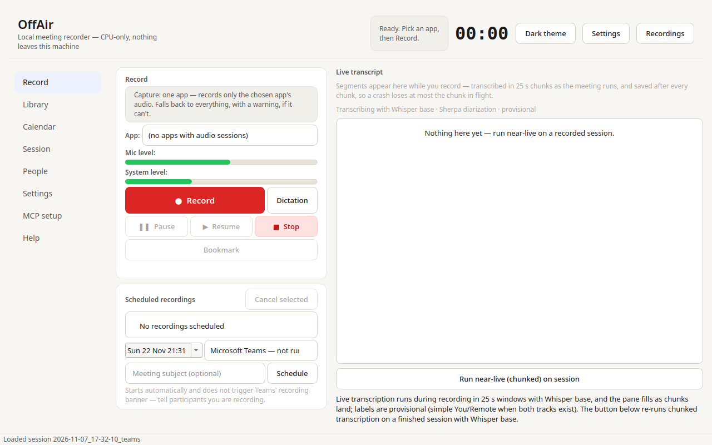
*Record view, light theme (the default) — app picker, capture-mode callout, live level meters, Record/Pause/Stop, the Bookmark button on its own row below the transport buttons, the Dictation toggle beside Record, the "Scheduled recordings" card below, and the live transcript beside it, with the "Transcribing with Whisper base" line naming the model and diarization mode in use. The theme toggle sits in the header.*

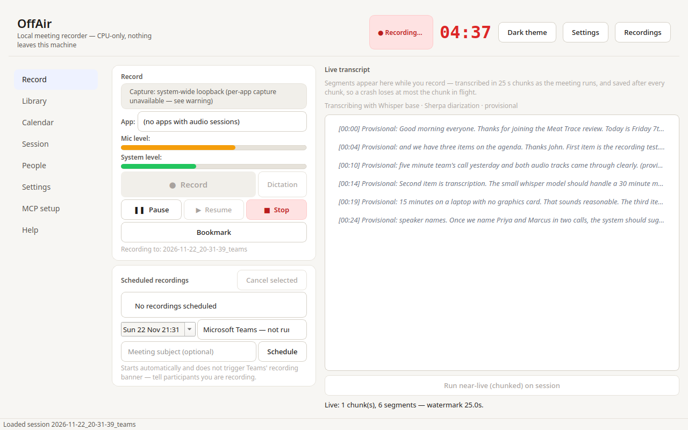
*Mid-recording — red status pill, running timer, live meters,
Pause/Stop enabled, the Bookmark button on its own row below the
transport buttons, the "Scheduled recordings" card below the Record
card, and the first live chunk (25 s) landing in the live transcript
as the meeting runs, grey and italic, marked "provisional".*

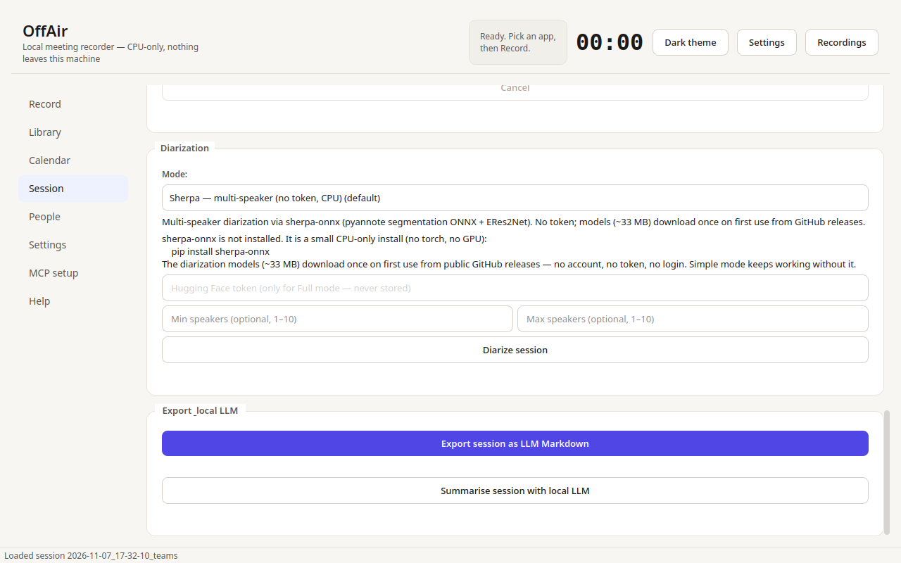
*Session view, light theme, scrolled to the Diarization group — sherpa
mode selected, with the install note shown when sherpa-onnx is absent.*

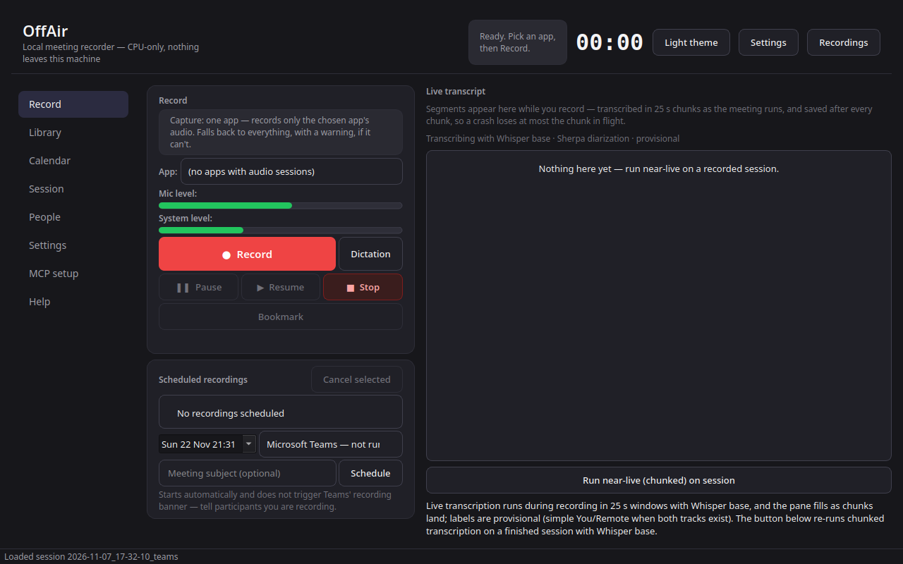
*Same Record view, dark theme.*

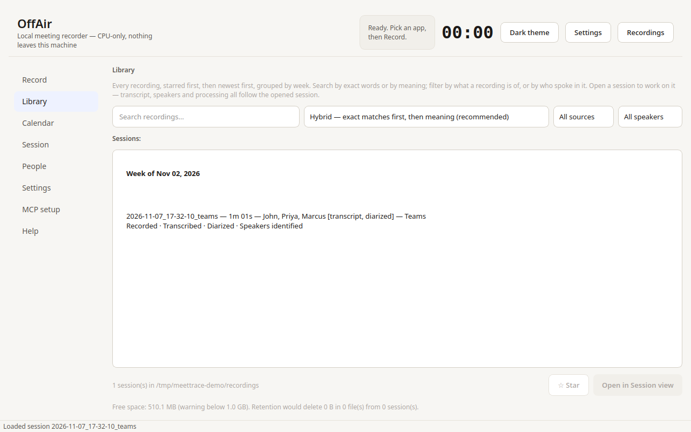
*Library — session list, pinned sessions first, grouped under week
headers ("This week", "Week of …"), search with the Hybrid /
Text / Semantic mode picker, the source filter and the speaker
filter, a star button per row, and the disk line in the footer.
(The calendar has its own Calendar page now.)*

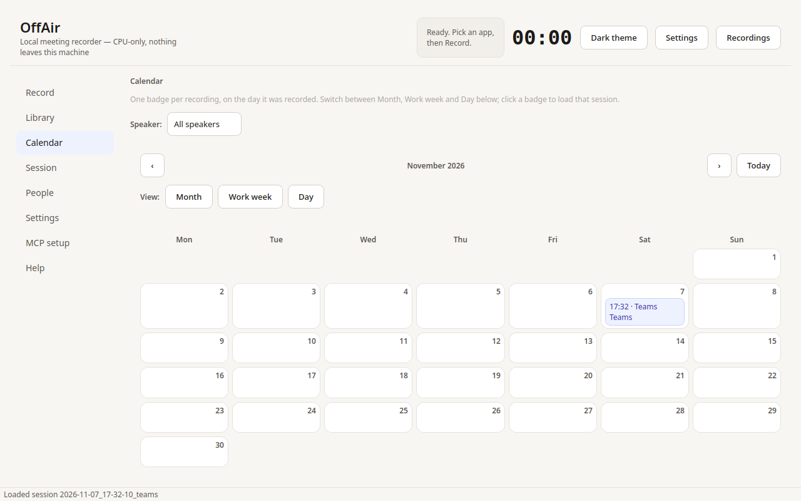
*Calendar — November 2026 with the Nov 7 demo session's badge
(time, app, source). Month | Work week | Day switches the view;
click a badge to load that session; ‹ / › step one period at a
time, Today jumps back to the current period. The speaker filter
above the grid dims days with no matching session.*

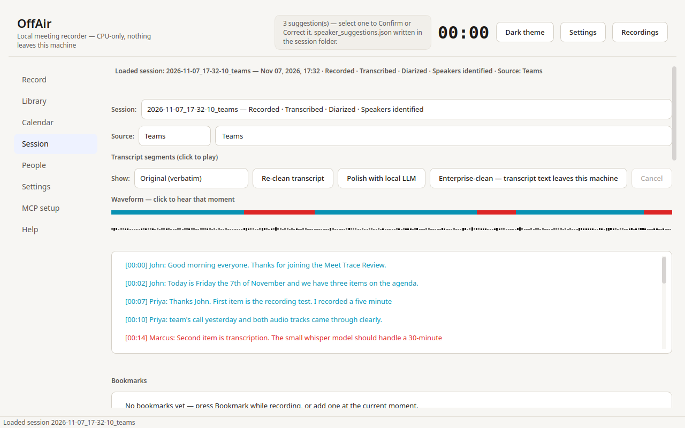
*Session view — the loaded session's transcript (Original / Cleaned
/ Enterprise-cleaned toggle, Re-clean, Polish, Enterprise-clean),
the waveform timeline with speaker colours and bookmark markers,
the bookmark list, and the speaker suggestions for this session
with confidence and margin.*

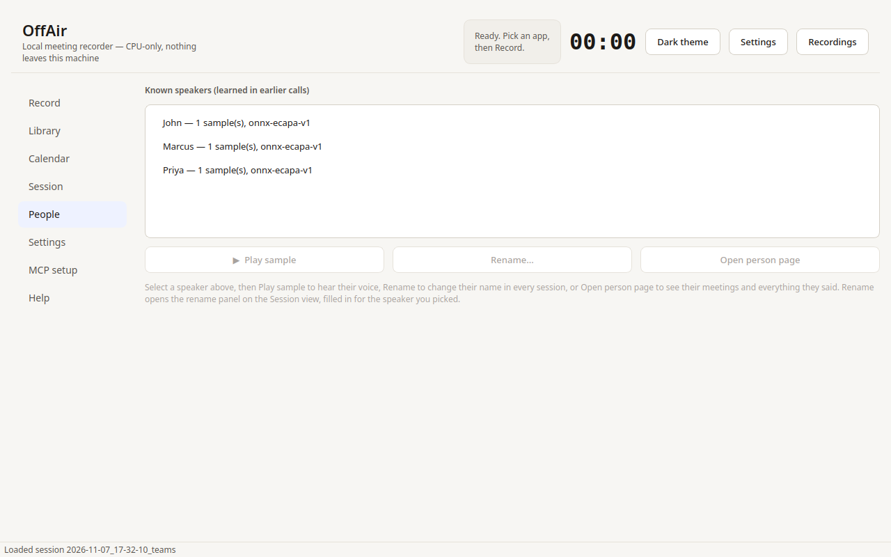
*People — known speakers learned in earlier calls (John, Priya,
Marcus in the demo). Select a speaker to Play sample, Rename, or
Open person page; Rename opens the rename panel on the Session
view. A person page lists that speaker's meetings and utterances
with click-to-play, plus their voice sample.*

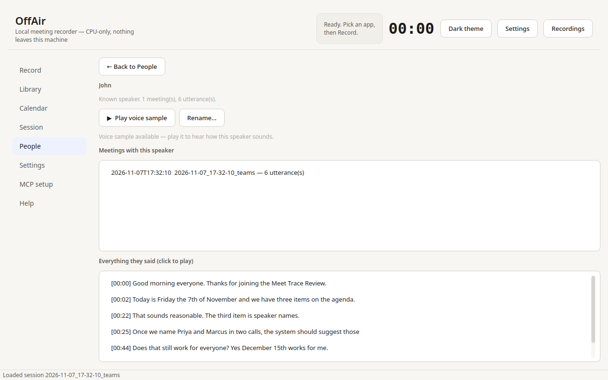
*Person page — John's meetings with utterance counts, everything
he said (click to play), and his voice sample, with Rename.*

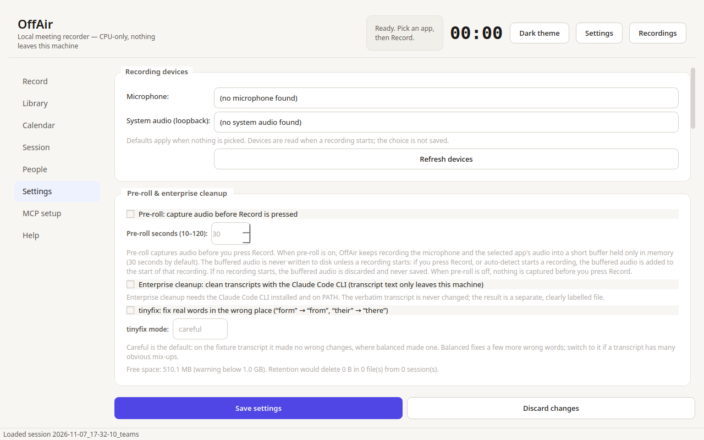
*Settings view, scrolled to the top — "Recording devices"
(microphone / system audio, Refresh devices) at the top, then the
"Pre-roll & enterprise cleanup" section with the pre-roll consent
note, the enterprise-cleanup opt-in, and the tinyfix checkbox,
unchecked (off by default; mode "careful"), and the disk line, with
Save settings / Discard changes at the bottom. The rest of the
Settings form (output folder, capture mode, source, models) lives
further down the same scroll area.*

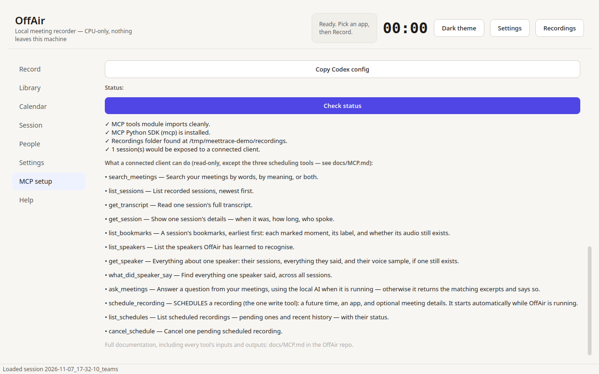
*MCP setup view, scrolled to the bottom of the page — the "Copy
Codex config" button, the on-demand status check (all four checks
green: tools module imports, SDK installed, recordings folder
found, sessions exposed), and the twelve-tool list in plain
language, with the scheduling exception stated ("read-only, except
the three scheduling tools"). The top of the page (above the fold)
holds the run command and the copy-paste configs for Claude Code,
Claude Desktop, and Codex.*

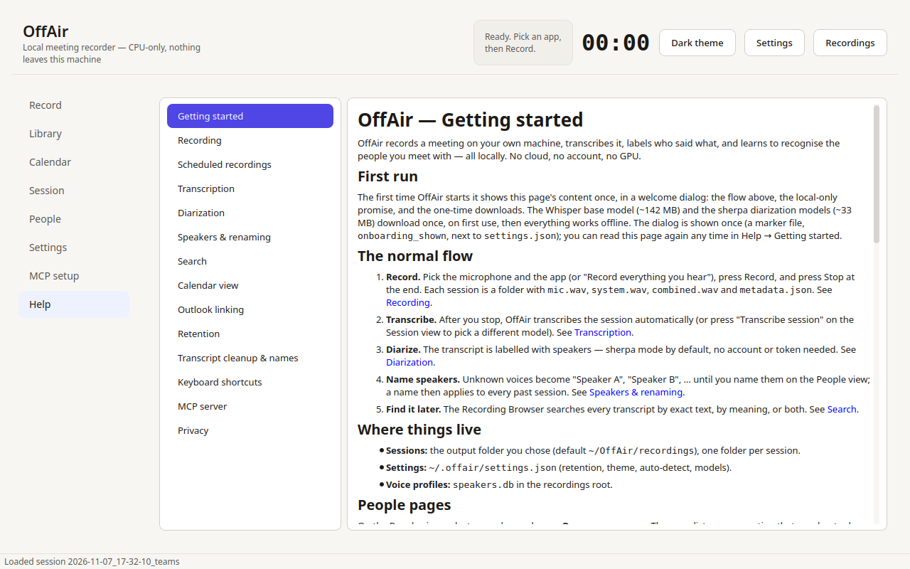
*Help view — section list on the left, the repo docs rendered on the
right (Getting started shown).*

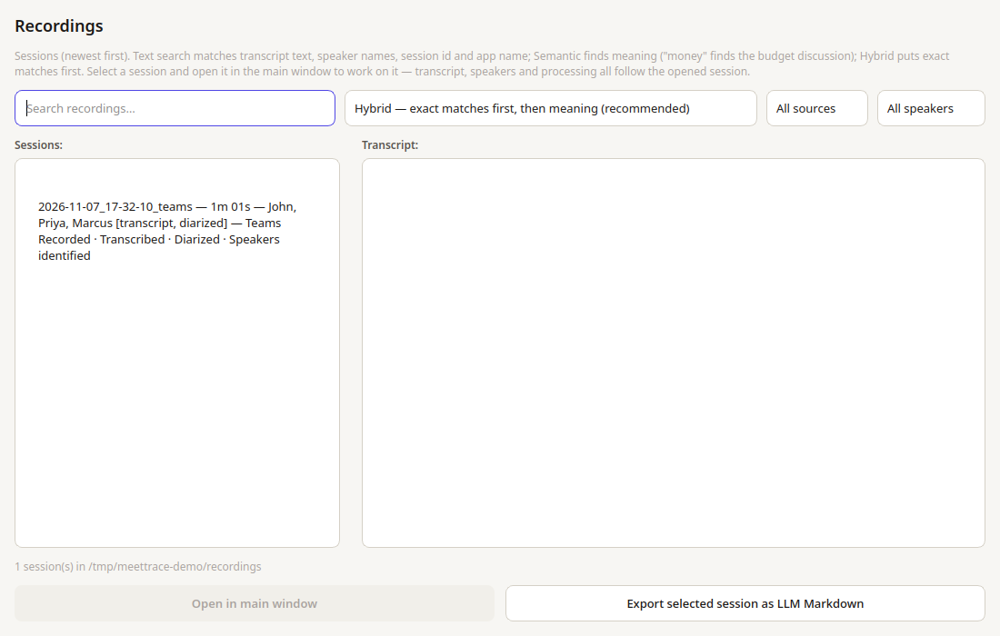
*Recording Browser — all sessions, newest first, each with a human status line. Select one and click "Open in main window" (or double-click it) to load it into the main window.*

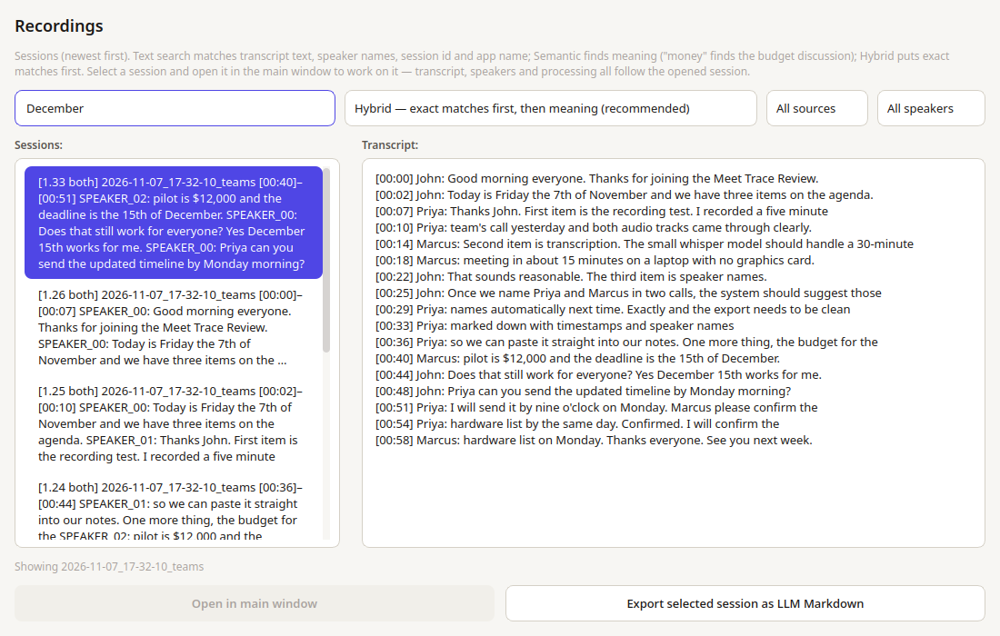
*Search: "December" finds the deadline discussion.*

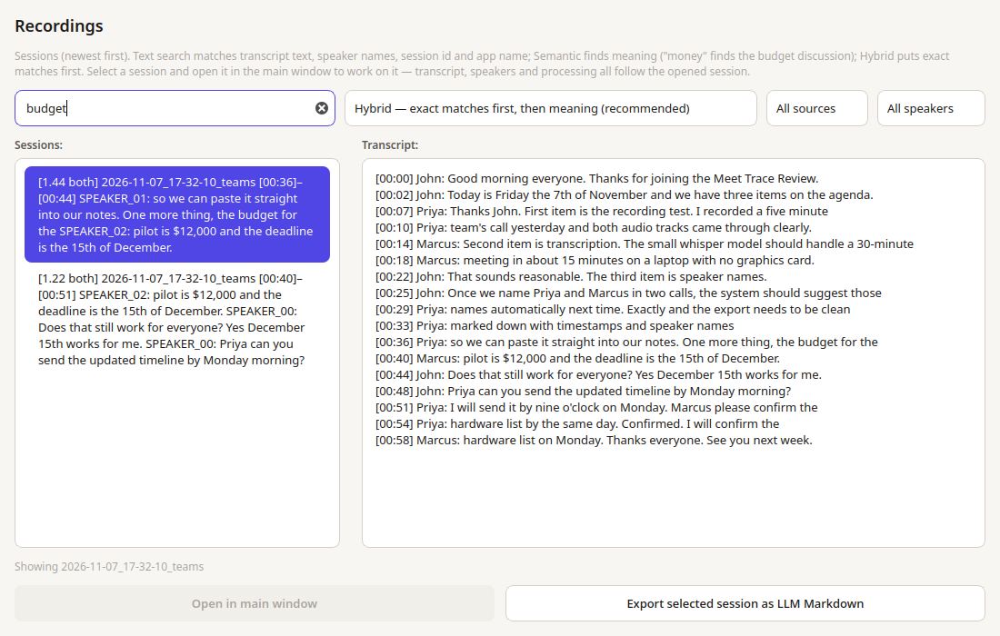
*Exact-words search: "budget" finds the session — the word appears in the transcript ("the budget for the pilot is $12,000").*

Rendered offscreen on Linux from the demo sessions, so the device
dropdowns show "(no microphone found)" — the render machine has no
audio hardware. On a real machine they list your mic and loopback
devices.
